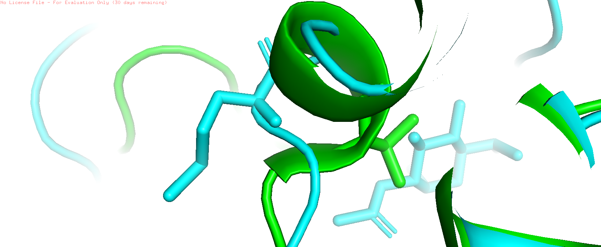

# Manuscript Title: Bioinformatic Analysis of Epimerase Deficiency Galactosemia
**Authors:** Mengxin Lin Huang, Marta Celdrán Abraldes, Elena Alexandra Gae Dumitru, Adrià Cuadros Farré-Escofet  
**Department, Institution, City, Country:** BBI,Polytechnic University of Catalonia, Barcelona, Spain

## Abstract
*Provide a structured abstract covering Background, Results, and Conclusions (Max 350
words).*

## Keywords
[Keyword 1, Keyword 2, Keyword 3, Keyword 4, Keyword 5]

## Background

Galactose is a sugar found mainly in milk and dairy products. The body converts it into glucose so it can be used as energy. Galactosemias are a group of inherited disorders in which this process fails and galactose accumulates in the blood [1].

The *GALE* gene (chromosome 1, 1p36.11) encodes the enzyme UDP-galactose 4-epimerase [3,14]. This enzyme catalyses two reversible reactions: the interconversion of UDP-glucose and UDP-galactose, and of UDP-N-acetylglucosamine and UDP-N-acetylgalactosamine [14,15]. The second reaction is important because these sugars are needed to build glycoproteins and glycolipids [15]. Several alternatively spliced transcripts of *GALE* have been described, and they encode the same protein [15].

Mutations in *GALE* cause epimerase-deficiency galactosemia (EDG, galactosemia type III), an autosomal recessive disorder [2,7]. Three forms of EDG are distinguished according to how widely the enzyme activity is reduced [7,8]. In the generalized form, enzyme activity is profoundly decreased in all tissues tested. Affected infants show hypotonia, poor feeding, vomiting, jaundice, hepatomegaly, liver dysfunction and cataracts, and long-term features can include short stature, developmental delay, sensorineural hearing loss and skeletal anomalies. In the peripheral form, activity is deficient only in red and white blood cells and is normal or near normal in other tissues. In the intermediate form, activity is deficient in blood cells and below 50% of normal in the other cells tested. It has been reported that peripheral and intermediate EDG are difficult to tell apart [7]. Treatment is based on a galactose-restricted diet, which resolves or prevents the acute symptoms but not the developmental delay or learning impairment seen in some patients [7].

Several missense variants in *GALE* have been reported in OMIM, including p.Val94Met [3]. However, it is not fully understood how a single amino-acid change affects the structure and function of the enzyme. In this study, we compared the wild-type and mutant *GALE* sequences, analysed their conservation across species (human, mouse and *Escherichia coli*), and examined the 3D structural environment of the mutated residue using PDB structures. Our aim is to explain how this variant may cause EDG.

## Results

### Identification of the human GALE sequences

The wild-type (WT) CDS search identified the human gene GALE (UDP-galactose-4-epimerase; Gene ID 2582, HGNC:4116, MIM 606953) at locus 1p36.11 on chromosome 1 (NC_000001.11), with the RefSeq record NM_000403.4. The gene has 13 exons and is expressed broadly, with the highest levels in the stomach and duodenum. The WT protein search identified NP_000394.2 (348 aa), the product of this gene, named UDP-galactose 4-epimerase (also listed as UDP-glucose 4-epimerase).

The mutant sequences matched the same records. The mutant CDS had its best hit on NM_000403.4 with 99.90% identity to the WT CDS (1046/1047 nucleotides; query cover 100%, E-value 0.0) and the mutant protein had its best hit on NP_000394.2 with 99.71% identity to the WT protein (347/348 amino acids; query cover 100%, E-value 0.0).

Homologous sequences were selected for the cross-species comparison: for Mus musculus, the gene Gale (CDS NM_001356493.1; protein NP_001343422.1, 347 aa), and for Escherichia coli, the gene galE (protein NP_415280.3, 338 aa, from strain K-12 MG1655; nucleotide record OZ544371.1, from strain RSZYD15081311_A, which is not K-12). The human reference sequences are NM_000403.4 and NP_000394.2 (348 aa).

A blastp search of the E. coli protein against the human protein gave 98% query cover, 52.49% identity and an E-value of 1e-134. In the blastn comparison of the human CDS with OZ544371.1 a genome assembly, chromosome 1, 2 314 235 nt; the aligned segment is at positions 176 507–176 736, the alignment covered 22% of the human CDS (positions 532–761), with 76.19% identity and an E-value of 5e-40. A search against the E. coli genome gave 25% query cover and 71.5% identity. In both cases only a short segment of the human CDS aligned. The protein and the nucleotide sequences come from different E. coli strains.

### Comparison of the WT and mutant sequences

The WT and mutant CDS are both 1047 nt long and differ at one position only, with no gaps (1046/1047 identities, 99.90%). The difference is at position 280, where the WT has G and the mutant has A, a transition (c.280G>A).

The WT and mutant proteins are both 348 aa long and also differ at one position only, with no gaps (347/348 identities, 99.71%). The difference is at position 94, where valine (Val, V) in the WT is replaced by methionine (Met, M), written p.Val94Met. 

Codon 94 occupies nucleotides 280–282, and position 280 is its first base. The G>A change converts GTG (Val) to ATG (Met), so the substitution is missense: the new codon still encodes an amino acid, and the stop codon is unchanged. No nucleotides are inserted or deleted, so the reading frame is not altered.

Valine and methionine are both non-polar, hydrophobic and uncharged, so charge and polarity are the same. They differ in chemical class and side-chain volume: valine is aliphatic with a medium volume (140.0 ų), whereas methionine is a sulfur-containing amino acid with a larger volume (162.9 ų) (Pommié et al. 2004).

### Conservation across species: CDS

The CDS could not be compared in a single three-way alignment, because blastn aligned only 22% of the human CDS with the E. coli sequence. Human vs mouse and human vs E. coli were therefore aligned separately, with the human WT CDS as the query in both runs (Table 1).

Table 1. Identity and coverage of the WT human sequences against mouse and E. coli.

| Comparison | 	Level | Query cover | Identity | 	Identity per 60-position block |
|---|---|---|---|---|
| *Human vs mouse* | CDS | 99% (positions 7–1047) | 89.15% | 80.00–96.67% (18 blocks) |
| *Escherichia coli* | CDS | 	22% (positions 532–761) | 76.19% | 74.0–80.0% (4 blocks) |
| *Human vs mouse* | Protein | 99% | 93.93% (325/346) | 91.67–96.67% (6 blocks) |
| *Human vs E. coli* | Protein | 98% | 52.49% (179/341) | 40.48–80.00% (6 blocks) |

Human and mouse CDS align over almost their whole length (E-value 0.0). Identity differs between blocks: the blocks at positions 367–426 and 847–906 have two and three mismatches per 60 nt, whereas the block at positions 547–606 has 12 mismatches. For E. coli, blastn aligned only one segment of about 230 nt (positions 532–761, E-value 5e-40; 176/231 identities, 76.19%). Outside this segment the human CDS has no alignment with the E. coli sequence. This segment corresponds approximately to residues 178–254 of the protein.

Human vs mouse shows 113 substitutions (928/1041 identities, no gaps), spread along the sequence; 88 of them are at the third base of a codon, 12 at the first and 13 at the second. The first six nucleotides of the human CDS are not aligned, and the mouse CDS is 1044 nt long against 1047 nt for human. Within the segment aligned with E. coli there are 53 substitutions and two gaps. Position c.280 is G in both human and mouse, so it is identical in these two species. It lies outside the segment aligned with E. coli and could not be compared.

### Conservation across species: protein

The human protein is 93.93% identical to the mouse protein and 52.49% identical to the E. coli protein (Table 1). Of the 346 human positions covered by the three-way alignment (residues 3–348), 177 (51.2%) are identical in human, mouse and E. coli. The longest stretches identical in the three species are residues 85–102 (VIHFAGLKAVGESVQKPL, 18 aa), 198–211 (GEDPQGIPNNLMPY), 232–244 (TEDGTGVRDYIHV) and 129–137 (FSSSATVYG). The N-terminal stretch at residues 8–17 (TGGAGYIGSH) is identical in mouse and has one substitution in E. coli (A11S), and the stretch at residues 157–161 (YGKSK) is identical in the three species. Identity with E. coli is lowest in residues 19–47 (7 of 29 positions identical) and in the C-terminal residues 303–348 (17 of 46).

Compared with human, the mouse protein has 21 substitutions (L28S, F39I, G42E, G43D, L45M, G71A, R75H, Y80H, M83K, K120R, Q173R, K176T, T177A, T189I, C196R, N228D, D231A, R256K, I266T, Q315H, T346A) and no internal gaps. The E. coli protein has 156 substitutions and one internal gap of six residues, corresponding to human residues 41–46 (GGGSLP). Human residues 1–3 and 345–348 have no counterpart in the E. coli alignment.

### Comparison of the CDS and protein alignments

Mouse differences are located at residues 28–83 (nine of the 21) and 173–177 (three of the 21). In the E. coli protein comparison, the identity per block is lowest in the last block (residues 303–344) and highest at residues 183–242 (80.00%). At CDS level, the only region of the E. coli sequence that aligned is the segment at positions 532–761.

The two alignments do not show the same number of differences. Human vs mouse has 113 nucleotide differences but 21 amino-acid differences.

For mouse, identity is higher at protein level (93.93%) than at CDS level (89.15%). For E. coli, the protein aligned over 98% of the human protein and the CDS over 22% of the human CDS, so the two percentages are not directly comparable.

Valine 94 is identical in human, mouse and E. coli, and lies inside the longest stretch conserved in the three species (residues 85–102).

### Experimental 3D structures
Protein Data Bank (Table 2). The sequence of 1EK5 is identical to the WT protein. The sequence of 1I3N has methionine at position 94 and also differs from the WT protein at position 180 (Ala in the WT, Val in 1I3N).

| Feature | Wild Type (WT) Structure | Mutant (V94M) Structure |
| :--- | :--- | :--- |
| **PDB ID** | **1EK5** | **1I3N** |
| **Experimental Method** | X-ray Diffraction | X-ray Diffraction |
| **Resolution** | 1.80 Å | 1.50 Å |
| **Organism** | *Homo sapiens* | *Homo sapiens* |
| **Mutation** | None (WT - Val94) | V94M (p.Val94Met) |
| **Ligands / Cofactors** | NAD | NAD, UDP-N-acetylglucosamine, chloride, magnesium |
| **Chains in the asymmetric unit** | One (chain A); the dimer is generated by symmetry | Two (A and B) |

[results of tasks 3.5 and 3.6]

**Figure 1. Structural superposition of human WT GALE (1EK5) and V94M mutant (1I3N).** 
Superposition of WT (green, 1EK5) and V94M mutant (cyan, 1I3N) structures zoomed in on position 94. The p.Val94Met substitution replaces valine with a larger methionine side chain, causing steric hindrance and a displacement of the neighboring loop (Ala93–Glu96).

**Structural Impact of p.Val94Met:**
The substitution of Val94 with Met94 introduces a bulkier, sulfur-containing side chain into a highly conserved, tightly packed region (residues 85–102). Comparison between `1EK5` (WT) and `1I3N` (Mutant) reveals that the V94M substitution causes a slight displacement of the surface loop (Ala93 to Glu96), disrupting optimal active site geometry and destabilizing the core structure, which accounts for the reduced enzymatic activity in Epimerase-Deficiency Galactosemia.

## Discussion
[Discuss implications, compare with existing research, and highlight limitations.]

## Conclusions
[State the main conclusions and their significance.]

## Methods

### Literature and database searches

Background information on the disease, the gene and the variant was collected from the NCBI MeSH database, PubMed, OMIM and UniProt.

The NCBI MeSH database was searched with the query "galactosemias"[MeSH Terms] OR Epimerase-Deficiency Galactosemia[Text Word] and with the query "Epimerase"[MeSH Terms]. The MeSH records 68004926 (Escherichia coli) and 68017398 (Alternative Splicing) were also consulted, to define the terms for the literature on the alternative splicing of GALE. The clinical description of epimerase-deficiency galactosemia (types, diagnosis, management and inheritance) was taken from the PubMed record PMID 21290786 (GeneReviews) and from the NORD page on galactose epimerase deficiency. Articles on the effect of the V94M substitution were searched in PubMed (Comparison of Dynamics of Wildtype and V94M Human UDP-Galactose 4-Epimerase).

OMIM was used for the gene and the phenotype. The gene entry *606953 (GALE) was read for the gene location and the function of the enzyme, and its list of allelic variants (.0001 to .0008, which includes .0008, p.Val94Met) was used to identify the variants reported. The phenotype entry 
#230350 (galactosemia III) was read for the disease name, the mode of inheritance and the clinical features. UniProt (Q14376) was consulted for protein information (function,structure) Gene information was taken from NCBI Gene (Gene ID 2582) run at 09/10/2026.

### Sequences and sequence searches

The WT and mutant sequences were provided as FASTA files (CDS: EDG_CDS_WT.fasta, EDG_CDS_mutant.fasta; protein: EDG_protein_WT.fasta, EDG_protein_mutant.fasta). They were used as queries in NCBI BLAST (https://blast.ncbi.nlm.nih.gov/Blast.cgi; Altschul et al. 1990) to identify the gene and the protein. The CDS was searched with blastn against the core_nt database and the protein with blastp. Hits were selected for high query cover, high identity, a very small E-value, a matching description and organism, and a curated RefSeq record (NM_ or NP_) where available. These searches were run on 12 October 2026.

Homologues were searched in Escherichia coli (the protein NP_415280.3 is from strain K-12 MG1655, taxid:83333) and Mus musculus (taxid:10090) with the same programs, selecting the same criteria. The E. coli nucleotide sequence used for the CDS comparison was the record OZ544371.1, an E. coli genome assembly of strain RSZYD15081311_A (chromosome 1, 2 314 235 nt), which is not K-12. A preliminary blastn search against the E. coli genome returned genome (NC_) records and was not used further.

### Pairwise alignment of WT and mutant sequences

The WT and mutant CDS were compared with blastn, and the WT and mutant proteins with blastp, in both cases using the "Align two or more sequences" option. The WT sequence was the query and the mutant sequence the subject. The CDS comparison used the highly similar sequences algorithm (megablast) and the protein comparison used blastp, with default parameters in both. The alignments were run on 13 October 2026 and displayed as "Query-anchored with dots for identities" with a line length of 60. The position of the difference was read from the alignment block and its column, and the variant was named following HGVS nomenclature (c. for the CDS and p. for the protein).

### Cross-species alignments

The WT human CDS and protein were compared with the mouse and E. coli sequences using the "Align two or more sequences" option of NCBI BLAST. For the CDS, blastn was run with the human CDS (1047 nt) as the query and the E. coli and mouse sequences as subjects, each in a separate run with somewhat similar sequences and highly similar sequences actived respectively; other parameters were left at default; run on 19 Octuber 2026. The E. coli CDS did not align over most of its length, so the CDS comparison was done in two pairs (human vs mouse and human vs E. coli). For the protein, blastp was run with the human protein (348 aa) as the query and the mouse (347 aa) and E. coli (338 aa, NP_415280.3) proteins as subjects in the same alignment [run on 15 October 2026; RID D21P1GCA114]. All alignments were displayed as "Query-anchored with dots for identities", with the human sequence as the reference. Variable positions were identified as letters other than a dot, or as gaps (-), relative to the human sequence. Only WT sequences were used in the cross-species comparison.

The multiple alignment of the three proteins with the consensus line (* identical, : strongly similar, . weakly similar) was produced with CLUSTAL on 14 October 2026.

### Calculation of identity and conservation

Percentage identity and query cover were taken from the BLAST output. Identity over each 60-position block of the alignment was calculated as **the number of identical positions divided by the number of aligned positions in the block, multiplied by 100** by using the code of Python. Positions identical in the human, mouse and E. coli proteins were counted position by position in the three-way protein alignment. Conserved stretches were defined as runs of consecutive positions identical in the three species. The codon position of each nucleotide difference in the human vs mouse alignment was calculated from its position in the human CDS.

##### 1. WTCDS - mutantCDS

| Section | Percentage Identity |
|:--|--:|
| **SECTION 1** | 100,0% |
| **SECTION 2** | 100.0% |
| **SECTION 3** | 100.0% |
| **SECTION 4** | 100.0% |
| **SECTION 5** | 98.33% |
| **SECTION 6** | 100.0% |
| **SECTION 7** | 100.0% |
| **SECTION 8** | 100.0% |
| **SECTION 9** | 100.0% |
| **SECTION 10** | 100.0% |
| **SECTION 11** | 100.0% |
| **SECTION 12** | 100.0% |
| **SECTION 13** | 100.0% |
| **SECTION 14** | 100.0% |
| **SECTION 15** | 100.0% |
| **SECTION 16** | 100.0% |
| **SECTION 17** | 100.0% |
| **SECTION 18** | 100.0% |

##### 2. WTCDS - E. coli

| Section | Percentage Identity |
|:--|--:|
| **SECTION 1** | 76.7% |
| **SECTION 2** | 80.0% |
| **SECTION 3** | 75.0% |
| **SECTION 4** | 74.0% |

##### 3. WTCDS - Mus musculus

| Section | Percentage Identity |
|:--|--:|
| **SECTION 1** | 91.67% |
| **SECTION 2** | 83.33% |
| **SECTION 3** | 93.33% |
| **SECTION 4** | 88.33% |
| **SECTION 5** | 90.00% |
| **SECTION 6** | 86.67% |
| **SECTION 7** | 96.67% |
| **SECTION 8** | 91.67% |
| **SECTION 9** | 90.00% |
| **SECTION 10** | 80.00% |
| **SECTION 11** | 90.00% |
| **SECTION 12** | 85.00% |
| **SECTION 13** | 81.67% |
| **SECTION 14** | 90.00% |
| **SECTION 15** | 95.00% |
| **SECTION 16** | 93.33% |
| **SECTION 17** | 90.00% |
| **SECTION 18** | 85.71% |

##### 4. WTProtein - mutant Protein

| Section | Percentage Identity |
|:--|--:|
| **SECTION 1** | 100,0% |
| **SECTION 2** | 98.33% |
| **SECTION 3** | 100.0% |
| **SECTION 4** | 100.0% |
| **SECTION 5** | 100.0% |
| **SECTION 6** | 100.0% |

##### 5. WTProtein - E. coli

| Section | Percentage Identity |
|:--|--:|
| **SECTION 1** | 51.67% |
| **SECTION 2** | 48.33% |
| **SECTION 3** | 48.33% |
| **SECTION 4** | 80.0% |
| **SECTION 5** | 53.33% |
| **SECTION 6** | 45.65% |

##### 6. WTProtein - Mus musculus

| Section | Percentage Identity |
|:--|--:|
| **SECTION 1** | 91.67% |
| **SECTION 2** | 91.67% |
| **SECTION 3** | 95.00% |
| **SECTION 4** | 93.33% |
| **SECTION 5** | 96.67% |
| **SECTION 6** | 95.65% |

All sections present a percentage identity > 90%, the highest being *SECTION 5* with 96.67% and the lowest *SECTION 1* and *SECTION 2* with 91.67%. Nevertheless, all sections present high similarity.

### Protein structures

Experimental structures of human GALE were searched in the RCSB Protein Data Bank (https://www.rcsb.org) and in UniProt (Q14376). Structures were selected for being human, determined by X-ray diffraction, having the WT sequence or the V94M substitution, and having a published study. 1EK5 (WT; Thoden et al. 2000) and 1I3N (V94M; Thoden et al. 2001) were chosen because of its lowest resolution and correct length. Their sequences were compared with the WT protein sequence. Resolution, ligands, chains and the associated publications were taken from the RCSB entries on 20 October 2026. The structures were visualised in  and superposed with . The structures were visualised and superposed in PyMOL using the align command. The structural environment of residue 94 was analysed by inspecting side-chain volume differences and local backbone displacements between 1EK5 (WT) and 1I3N (mutant)

Amino acid properties

The properties of valine and methionine (hydropathy, volume, chemical class, charge and polarity) were taken from the IMGT classes of the 20 common amino acids (https://www.imgt.org/IMGTeducation/Aide-memoire/_UK/aminoacids/IMGTclasses.html; Pommié et al. 2004).

### Presentation of the data

Tables and figures were prepared from the BLAST output and the structure images. The sequence files and the alignments are stored in the repository.

---

*(this should be added to discussion)*

## Sequence Alignment Analysis

#### 1. WTCDS vs. Mutant CDS

| Alignment | Percentage Identity | Coverage |
|:--|--:|--:|
| WTCDS - mutant CDS | 99.90% | 100% |
| WTProtein - mutant Protein | 99.71% | 100% |

> Although the nucleotid sequence alignment has a higher identity percentage, the variation in both cases is only one component of the sequence. The mutation consists of a substitution at nucleotide 280 that corresponds to a V --> M substitution at amino-acid position 94. The highest percentage of the CDS sequence is due to a greater ammount of nucleotids in the sequence than aminoacids, as three nucleotids (a codon) are needed to form an aminoacid during traduction. This is called a missense mutation.

---

#### 2. WTCDS vs. *E. coli*

| Alignment | Percentage Identity | Coverage |
|:--|--:|--:|
| WTCDS - E. coli | 76.19% | 22% |
| WTProtein - E. coli | 52.49% | 98% |

> The highest percentage identity is the WTCDS - E. coli alignment. Although it is higher, this is only because it is a percentage made within the section that BLAST covered, which is only a 22% of the sequence provided. This suggests that the rest of the sequence doesn't align with the human protein sequence and, therefore, would have a significantly lower identity percentage than the protein's if 98% of the sequence had been taken into account aswell.

---

#### 3. WTCDS vs. *Mus musculus*

| Alignment | Percentage Identity | Coverage |
|:--|--:|--:|
| WTCDS - Mus musculus | 89.15% | 99% |
| WTProtein - Mus musculus | 93.93% | 99% |

> Both percentage identities are similar, but the highest is the protein sequence. This is because throughout the alignment there can be cases where the change of a nucleotid doesn't necessarily imply a change in the codificated aminoacid. Aminoacids can be codificated by different codon sequences at the same time, meaning that the change of a nucleotid could create a new codon that also codificates for that same aminoacid, making it a neutral mutation with no visible effect on the final protein.

---

[  https://www.ncbi.nlm.nih.gov/books/NBK26836/ ]

##The conservation of the genome and proteins throughout evolution

The conservation of the genome sequences between two different species depend on the ammount of time they have separately evolved. 
Also, purifying selection eliminates individuals that carry mutations that interfere with important genetic functions. Sequences that are subject to strong functional constraint (the sequence has an important impact on the organism's wellness) are often conserved.

According to the molecular-clock hypothesis, changes of specific sequences of genes and proteins are not sudden, but constant in time. This molecular clock runs faster in sequences that are not affected by purifying selection, and slower in those that suffer from strong functional constraints.

[https://www.uniprot.org/uniprotkb/Q14376/ ]

The general function of the gene UDP-glucose 4-epimerase (GALE) is to catalyze two analogous reactions: the reversible epimerization of UDP-glucose to UDP-galactose and the reversible epimerization of UDP-N-acetylglucosamine to UDP-N-acetylgalactosamine. The reaction with UDP-Gal plays a critical role in the Leloir pathway of galactose catabolism in which galactose is converted to the glycolytic intermediate glucose 6-phosphate. It contributes to the catabolism of dietary galactose and enables the endogenous biosynthesis of both UDP-Gal and UDP-GalNAc when exogenous sources are limited.

more specifically, it contains the following functional sites:

[https://www.uniprot.org/uniprotkb/Q14376/entry]
Positions 12-14, 33-37, 66-67, 88, 92, 161 and 185: binding sites for NAD+.
Position 157: active site of proton acceptor
Positions 132-134, 185-187, 206-208, 224-226, 239 and 300-303: binding sites for substrate

the studied mutation appears in postion 279, meaning that it does not directly affect any of the indicated functional sites. These are needed for the basic wellness of the organism and therefore are less prone to effective mutation. 

---

## Abbreviations
[List abbreviations used, e.g., AI: Artificial Intelligence.]

## Declarations
Availability of data and materials: [Statement on repository/access]
Authors' contributions: Specify roles

## References

## References

1. NCBI. MeSH search: "galactosemias" OR Epimerase-Deficiency Galactosemia. National Library of Medicine. https://www.ncbi.nlm.nih.gov/mesh/?term=%22galactosemias%22%5BMeSH%20Terms%5D%20OR%20Epimerase-Deficiency%20Galactosemia%5BText%20Word%5D&cmd=DetailsSearch
2. OMIM. Entry #230350: Galactosemia III; GALAC3. https://omim.org/entry/230350
3. OMIM. Entry *606953: UDP-galactose-4-epimerase; GALE. https://omim.org/entry/606953
4. NCBI. MeSH record 68004926. https://www.ncbi.nlm.nih.gov/mesh/68004926
5. NCBI. MeSH record 68017398. https://www.ncbi.nlm.nih.gov/mesh/68017398
6. NCBI. MeSH search: "Epimerase". https://www.ncbi.nlm.nih.gov/mesh/?term=%22Epimerase%22%5BMeSH+Terms%5D
7. Fridovich-Keil J, Bean L, He M, Schroer R. Epimerase deficiency galactosemia. In: Adam MP, Feldman J, Mirzaa GM, et al., editors. GeneReviews® [Internet]. Seattle: University of Washington. PMID: 21290786. https://pubmed.ncbi.nlm.nih.gov/21290786/
8. National Organization for Rare Disorders (NORD). Galactose epimerase deficiency. https://rarediseases.org/mondo-disease/galactose-epimerase-deficiency/
9. NCBI BLAST. Basic Local Alignment Search Tool. https://blast.ncbi.nlm.nih.gov/Blast.cgi
10. NCBI Nucleotide. NM_000403.4: Homo sapiens UDP-galactose-4-epimerase (GALE), transcript variant 1, mRNA. https://www.ncbi.nlm.nih.gov/nucleotide/NM_000403.4
11. NCBI Nucleotide. NM_001127621.2. https://www.ncbi.nlm.nih.gov/nucleotide/NM_001127621.2
12. NCBI Nucleotide. NM_001008216.2. https://www.ncbi.nlm.nih.gov/nucleotide/NM_001008216.2
13. NCBI Protein. NP_001126148.1. https://www.ncbi.nlm.nih.gov/protein/NP_001126148.1
14. UniProt. Q14376: UDP-glucose 4-epimerase (GALE_HUMAN). https://www.uniprot.org/uniprotkb/Q14376/entry
16. NCBI Gene. GALE UDP-galactose-4-epimerase [Homo sapiens], Gene ID: 2582. https://www.ncbi.nlm.nih.gov/gene/2582
17. RCSB Protein Data Bank. Structure of human UDP-galactose 4-epimerase in complex with NAD+. PDB ID: 1EK5. Available at: https://www.rcsb.org/structure/1EK5 (accessed 23 October 2026).
18. RCSB Protein Data Bank. Molecular basis for severe epimerase-deficiency galactosemia: X-ray structure of the human V94M-substituted UDP-galactose 4-epimerase. PDB ID: 1I3N. Available at: https://www.rcsb.org/structure/1I3N (accessed 23 October 2026).
19. IMGT Education. IMGT classes of the 20 common amino acids. Available at: https://www.imgt.org/IMGTeducation/Aide-memoire/_UK/aminoacids/IMGTclasses.html (accessed 23 October 2026).
20. Schrödinger, LLC. The PyMOL Molecular Graphics System, Version 3.1. Available at: https://pymol.org/ (accessed 24 October 2026).
